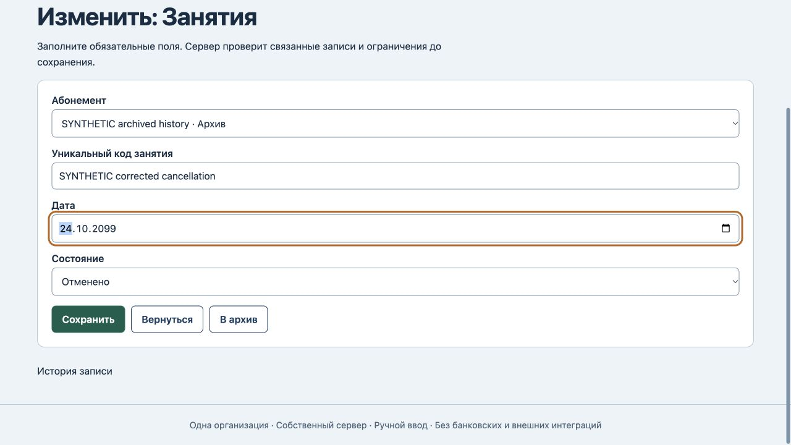
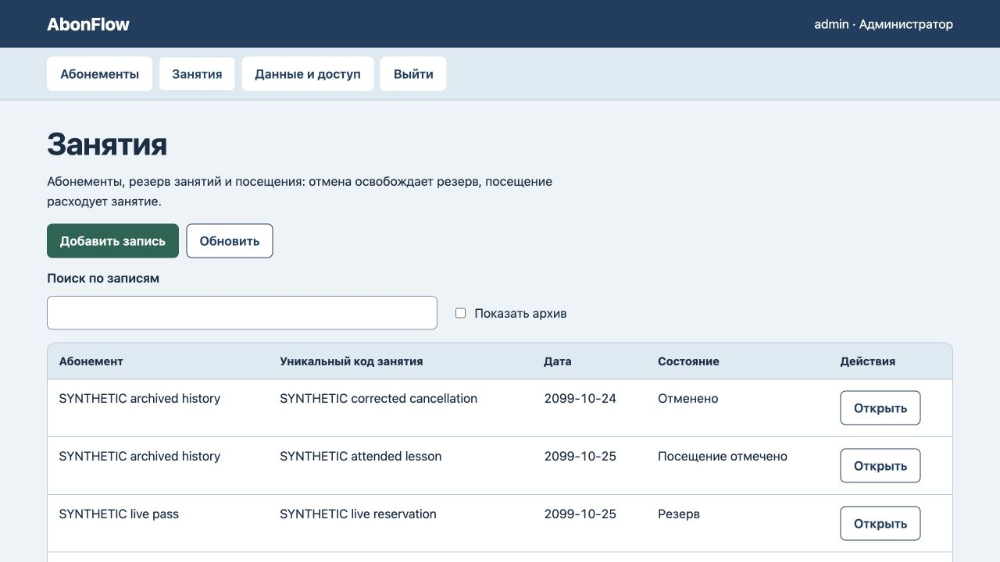

# AbonFlow: правка отменённого занятия

25 октября 2026. После архива абонемента редактор отменённого занятия терял выбранную ссылку. Обязательное поле становилось пустым, и браузер блокировал сохранение. Это воспроизведённый дефект формы. Сервер уже разрешал такую правку и защищал баланс; две добавленные проверки прошли ещё на прежнем коде.

Исправлен список формы: сохранённый архивный абонемент остаётся выбранным с пометкой «Архив». Другие архивы не предлагаются; новая форма показывает действующие абонементы. Сервер, предметные правила и схема не изменились.

Все 7 тестов прошли, включая файловый перезапуск и восстановление в пустую базу. Шесть прежних HTTP400 запретов и браузерный отказ возврата в резерв сохранили все данные, версию 8 и 8 записей журнала. Код и дата отменённого занятия сохранены с исходной ссылкой и статусом «Отменено»; остаток архивного абонемента остался 2. Новый резерв действующего абонемента создан. После reload: четыре занятия, версия 10 и 10 записей журнала; все абонементы, прежнее посещение и прежний резерв неизменны. [Машинные доказательства](history-verification.json).

Отменённая запись остаётся исправляемой историей: явный перенос к действующему абонементу разрешён. Прежний API допускает и отменённые записи без расхода по архиву; это поведение не менялось. Новое потребление, повторный резерв и перенос расхода в архив или паузу по-прежнему запрещены. Проведённая запись неизменяема. Ручной статус не подтверждает фактическое занятие.

Работающий сервер отдаёт точные новые байты app.js без перезапуска; 18 сохранённых областей, их версии и журналы не изменились. Полного нового аудита интерфейса или безопасности не проводилось. Оплаты, автоматического продления и рассылок нет.
