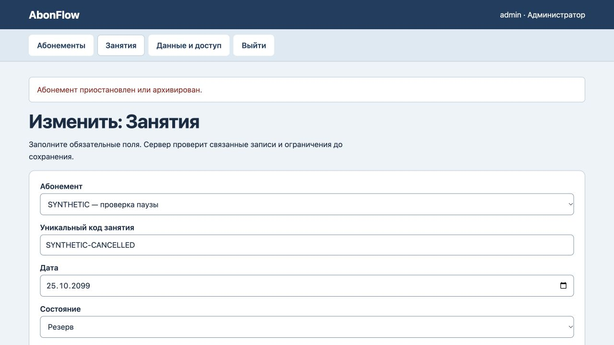
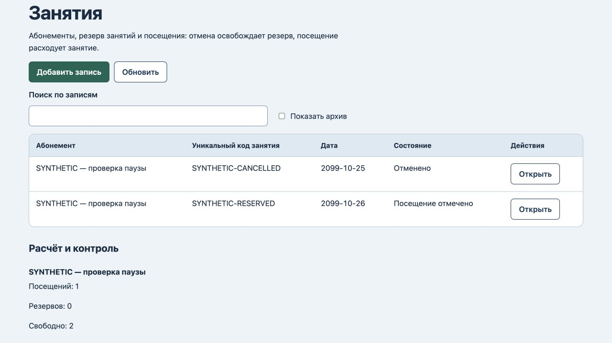

# Пауза абонемента: исправление24.10.2026

Воспроизведена ошибка: проверка активного абонемента выполнялась только при создании строки занятия. Правка отменённой строки позволяла новый резерв/посещение при паузе; перенос существующей строки обходил проверку целевого приостановленного абонемента. Новая регрессионная проверка на прежнем коде завершилась Missing expected exception.

Теперь новое потребление требует активного абонемента и при создании строки, и после отмены, и при переносе с другого абонемента. Имеющийся резерв на том же абонементе можно завершить или отменить. Проведённое посещение неизменяемо. После возобновления отменённое занятие можно снова зарезервировать.

Все5 тестов пройдены, включая возврат отмены, перенос, новый резерв, сохранность при отказе, завершение прежнего резерва, восстановление копии с историей при паузе и повторный резерв после возобновления. [Машинная запись проверки](pause-verification.json).

В браузере на отдельном синтетическом экземпляре: отменённое занятие при паузе не удалось вернуть в резерв и отметить посещённым. Сохранённые данные, остаток, версия4 и4 записи журнала не изменились. Прежний резерв успешно завершён:1 посещение,0 резервов,2 свободных занятия. Состояния прочитаны после обновления страницы.

Это исправление предметного правила, интерфейс и схема хранения не менялись. Не добавлены платежи, продление срока при паузе, уведомления или внешние интеграции. Сервер по-прежнему проверен локально.
